  

## 📌 About Me
- Machine Learning & Data Science: Experienced in building ML models and data pipelines using Python, with a focus on real-world predictive solutions 📊.
- Full-Stack Development: Proficient in building end-to-end web applications using React, Vue.js, Next.js, Node.js, Express.js, Django, and Flask, with a strong foundation in HTML, CSS, and JavaScript 🌐.
- Database Management: Skilled in designing and managing structured and unstructured data using MySQL, PostgreSQL, MongoDB, Redis, and SQLite 💾.
- Cloud & DevOps: Hands-on experience with containerization and cloud deployment using Docker, AWS, Google Cloud, Azure, and Jenkins ⚙️.

## 🔗 Connect with Me

  &nbsp;&nbsp;&nbsp;&nbsp;
  

## 🛠️ Tech Stack

  

  

## 🚀 Open-Source Contributions

  

<!--OSS:START-->
#### 🤝 Projects I've contributed to

#### ✅ Recently merged pull requests (0 merged in total)

| Project | Pull request | Merged |
|---|---|---|
| _Nothing yet, first PR coming soon_ | | |

Auto-updated 2026-10-17 00:00 UTC
<!--OSS:END-->

## 🐍 Contribution Graph

  <picture>
    <source media="(prefers-color-scheme: dark)" srcset="assets/github-snake-dark.svg" />
    <source media="(prefers-color-scheme: light)" srcset="assets/github-snake.svg" />
    
  </picture>

  

